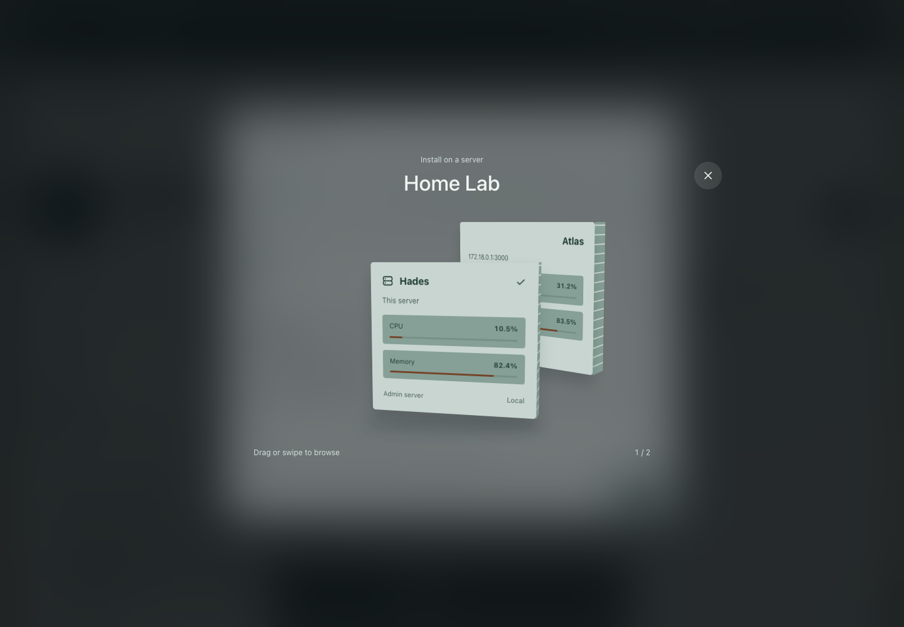
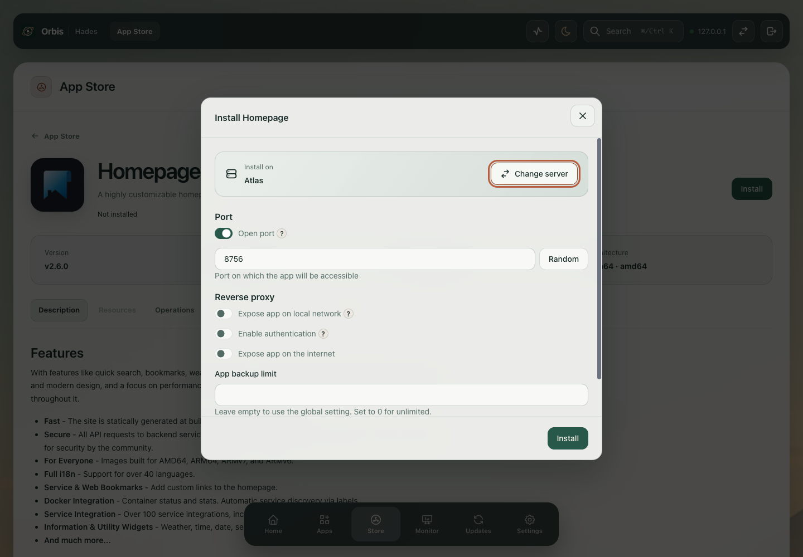
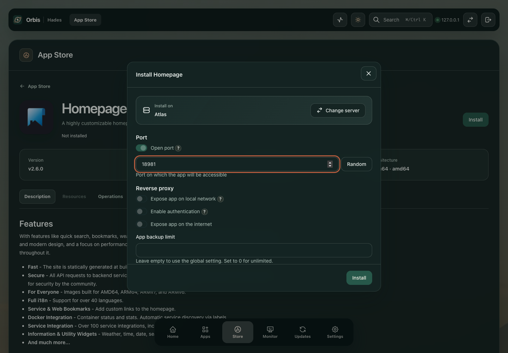
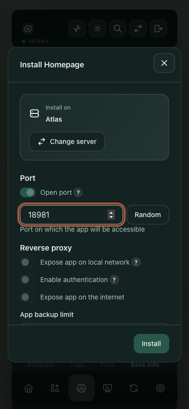

# App installation across servers

The admin dashboard browses a paired server's catalogue and loads that server's installation settings. **Change server** opens the rack selector; the chosen host supplies the app definition and available ports.

These captures show the built interface with two paired test installations. They do not depict a production homelab.

## Server selection

## Configuration

## Phone

