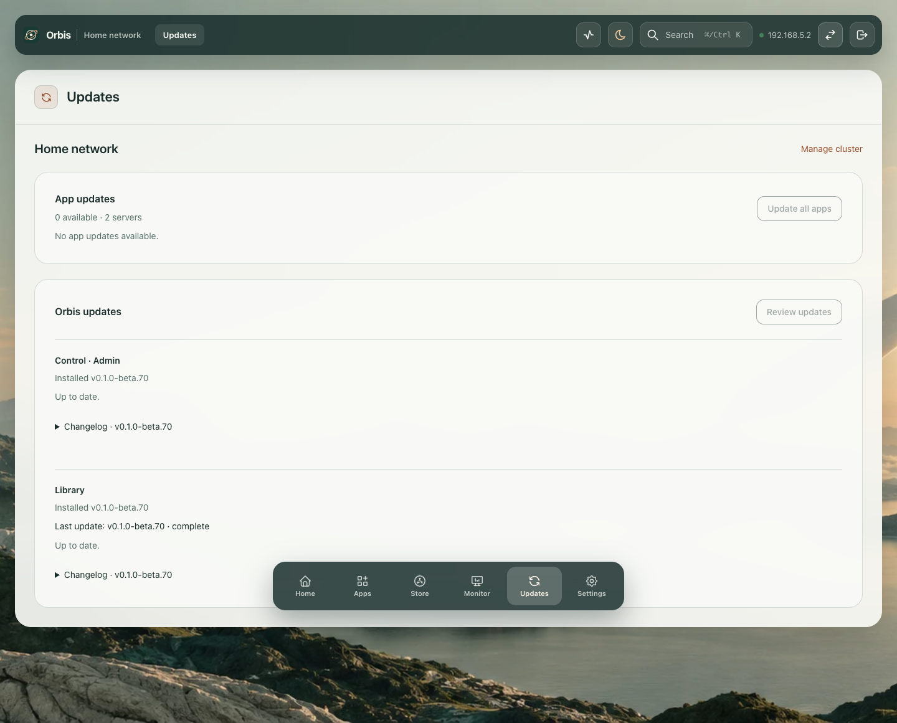
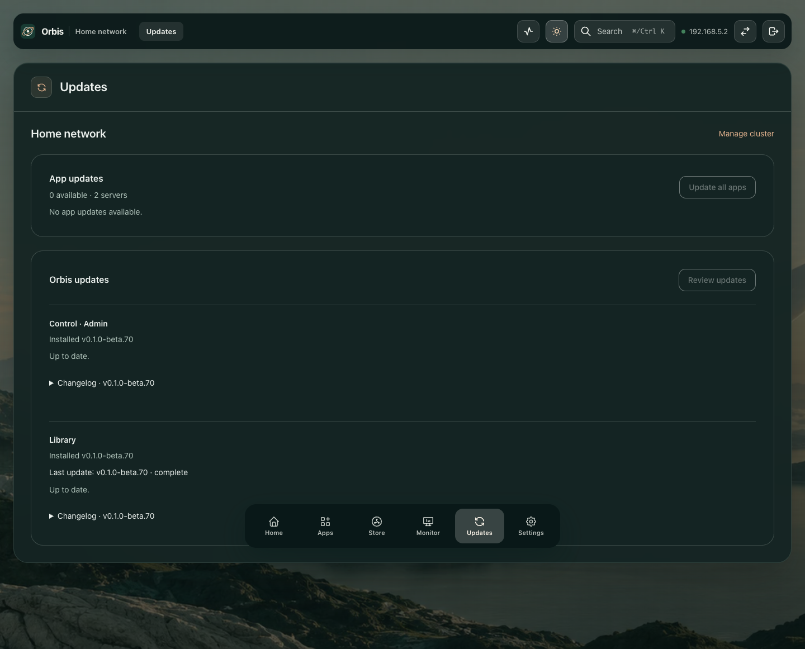
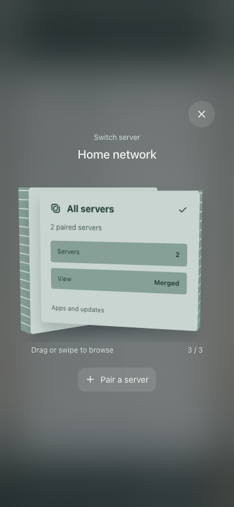

# Cluster updates

App updates and Orbis updates are listed separately for each paired server. Completed jobs show their target version.

These captures show two independent test hosts with the current interface. They do not depict a production homelab.

## Light

## Dark

## Phone server selector

