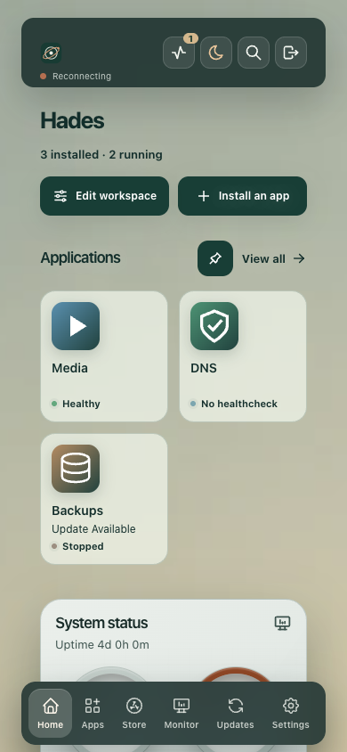

# Compact screen sizing

18 October 2026. Compiled-source Chrome fixtures on loopback8080, with intercepted synthetic APIs. These are not published-image or Hades captures.

| Check | Accepted |
| --- | --- |
| Native Home, Monitor, Appearance, Apps, Store, Updates, Login and Reset | 32/32 compositions at1440,768,390,320px |
| Doubled computed text, both modes,320/390px | 4/4 width/mode groups |
| Narrow forms, dialogs, errors and auth, native/doubled text | 20/20 surface samples |

Home native4 comes from the first run; Home is unchanged by the final Monitor-only disclosure adjustment. Other28 native compositions and final text checks use the final build. [Acceptance and limits](native-acceptance.json) · [First run](native-first-run.json) · [Final native run](native-final-run.json) · [320px text](text320-final.json) · [390px text](text390-final.json) · [Surfaces](surfaces320-final.json) · [Source fingerprints](../../verification/compact-scale-source.json).

| Native size | Desktop | Tablet | 390px | 320px |
| --- | --- | --- | --- | --- |
| Home title | 72px | 32px | 26px | 24px |
| Monitor title | 40px | 28px | 26px | 24px |
| Monitor section | 22px | 18px | 17px | 16px |
| CPU lead reading | 38px | 27px | 24px | 22px |

The scale uses relative units and normal layout. Existing small labels are retained; no transform or browser-zoom workaround is used. Enlarged text doubles measured font/line-height while root size, viewport and icons stay unchanged. Words, usable columns, shared Settings gutters, wrapped tab dividers, focus and dock clearance are checked directly. Manual review includes Home, Monitor, lower sections, Appearance and Login.

## Captures

[320px Home](320-home.png) · [Monitor](390-monitor.png) · [Monitor sections](390-monitor-sections.png) · [Appearance](320-appearance.png) · [Login](320-login.png) · [Recovery](320-recovery.png) · [Apps](320-apps.png) · [Store](320-store.png) · [Updates](320-updates.png) · [Doubled dark Home](320-dark-text2-home.png) · [Doubled Monitor](390-light-text2-monitor.png)

## Retained failures and boundaries

- The first native run rejected an invented32px minimum for an existing19.1875px disclosure. That verifier assumption is retained in the first report and [helper snapshot](native-first-run-helper.txt). It does not establish a compact-layout regression. The actual disclosure now has a40px target and padding, verified at all four widths.
- An interim text run failed during navigation/cleanup and retained only a destroyed-context cleanup error. Its cause is not established; [diagnostic](interim-text-cleanup-error.log) is retained. The verifier now preserves the primary error and attempts a failure capture before cleanup. Passing final runs are separate evidence.
- Existing36px Usage sorts,38px history ranges and some native summaries remain explicit target-size limitations. Not every control is claimed40px. Existing phone chrome has its separate36px contract.
- Native APIs are read-only. The surface suite makes four intercepted synthetic login posts; no real credentials/server are used. Unexpected writes and browser errors are zero. Helper listeners/routes/viewport are restored and pages close; the base driver's browser-close call has its existing5-second bound, without a separate close-completion flag.
- Chrome source fixtures and the listed flows only. Physical touch, Safari/Firefox, a newly published image, real-data migration and Hades remain separate gates.
