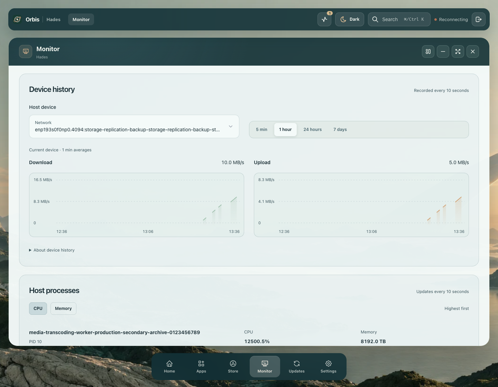

# Host device history verification

This directory records the compiled-source device-history UI and separate real Linux helper evidence after beta43. At the source checkpoint the core remained beta43: its current-reading API works with the upgraded rehearsal helper, but it has no per-device history API/UI yet. Real background collection, restart persistence and the next published-image acceptance remain required. Hades is untouched.

## Captures

[Dark desktop](desktop-dark-history.png) · [Doubled tablet inspection](tablet-double-inspection.png) · [Phone history](phone-light-history.png) · [Doubled phone plot](phone-double-history.png) · [Doubled phone inspection](phone-double-inspection.png) · [Device menu](phone-double-device-menu.png) · [Delayed device](phone-delayed-device.png) · [Narrow desktop window](narrow-desktop-double.png) · [Failed cached retry](phone-cached-retry.png) · [Successful retry](phone-retry-success.png)

These are local compiled Chrome fixtures with controlled device/process/history responses and rendered text scaling. They do not establish native browser zoom, Safari/Firefox, touch, every route, real history collection or published-image rendering. Source preferences stay in the browser fixture; narrow-window preference writes are shadows. No real app/account/host writes occur during browser inspection.

## Rejected defects

- A new-device request disabled its selector and removed the focused control. Keeping the catalogue and selector mounted now preserves focus while hiding previous-device values. [Rejected assertions](rejected-device-loading/report.json).
- After usable cached data, a failed poll followed by another failed Retry moved focus to a heading while Retry remained visible. Device history, host devices and host processes now retain the surviving Retry button on failure and focus their heading after recovery. All six desktop/doubled-phone regressions pass. [Rejected](rejected-cached-retry/report.json) · [Corrected](source-cached-retry/report.json).
- An initial phone graph passed text bounds but left only about 55px for the plot. Direct review rejected it. Compact containers now place the scale above a full-width plot: 166px at 320px and 236px at 390px, at native and doubled text. [Rejected capture](rejected-narrow-graph.png) · [Measurements](rejected-narrow-graph.json) · [Corrected cases](source-phones/report.json).

## Retained compiled-source checks

| Gate | Evidence |
| --- | --- |
| Final phone geometry | Eight cases: 320/390px, light/dark, native/doubled text; full-width plots, text clearance, selector/menu and native inspection. [Report](source-phones/report.json) |
| Desktop/tablet layout | Eight unchanged large-layout cases from the initial sixteen-case matrix. Initial phone plots are superseded above. [Report](source-layout-before-compact/report.json) |
| Interaction and states | Forty states, twenty range changes, five Retry recoveries, five actual ten-second refreshes, two default-device catalogue-growth cases and hidden/minimized polling. Focus and reading position are retained. [Report](source-functional/report.json) |
| Final pending/empty geometry | Thirty-two compact empty/null/loading cases, four delayed device/range cases, four real keyboard-resized narrow desktop cases and the final 1440px overview. [States](source-compact-states/report.json) · [Delayed](source-delayed/report.json) · [Narrow](source-narrow-window/report.json) · [Overview](source-overview/report.json) |
| Colours | Twelve preset/mode combinations; minimum measured small-label contrast 6.09:1. Final compact geometry inherits the same colours. [Report](source-colours/report.json) |
| Selected values | Eighty keyboard/pointer checks for direction, average, peak and count. [Values](selected-metric-values.json) |
| Original aggregate charts | Eight normal and two empty/null cases on the final renderer; CPU/memory at 768/320px, native/doubled text. [Report](source-existing-charts/report.json) |

[Source provenance](source-provenance.json) fingerprints product files, compiled assets, retained harnesses and captures. Final changes after the broad matrix are limited to narrow chart geometry and duplicate pending-copy removal; exact before/after relationships are retained. Final phone, state, narrow, delayed, overview and original-chart checks use that final build.

Reports are complete parsed JSON, split where necessary for repository tooling. Resolve `$orbis_array_parts` by concatenation and `$orbis_object_parts` by merging, recursively. Each manifest records original bytes/hash, canonical parsed hash and successful exact parsed reconstruction. Rejected reports deliberately retain failed assertions.

The entry point is `scripts/visual-qa.cjs` against the compiled local preview on port 8080. Set `ORBIS_VISUAL_HOST_HISTORY_ONLY=1`, optionally with one focused flag: `ORBIS_VISUAL_HOST_HISTORY_PHONES_ONLY`, `LAYOUTS_ONLY`, `FUNCTIONAL_ONLY`, `COLORS_ONLY`, `COMPACT_STATES_ONLY`, `DELAYED_ONLY`, `NARROW_ONLY`, `OVERVIEW_ONLY` or `SELECTION_ONLY` (each full flag starts `ORBIS_VISUAL_HOST_HISTORY_` and is set to `1`). `ORBIS_VISUAL_CACHED_RETRY_ONLY=1` runs the independent three-card cached-retry gate. Focused modes retain the same tested inspector functions and arguments.

## Real Linux identity probe

`linux-source-proof.json` comes from the opt-in `scripts/live-host-history-qa.py` probe on the owned arm64 Colima guest. A temporary source Unix handler reads eight actual interfaces and three disks. All 11 opaque history identities match independent kernel-derived digests, stay stable across two distinct samples and remain stable after constructing a new collector. First/new-collector rates stay unavailable until a comparison exists. The helper rejects parameterized paths and never returns the raw boot identifier.

The temporary server closes with every installed helper/environment/unit hash unchanged. This source probe does not record backend history or verify its persistence/rendering.

## Installed helper and backward compatibility

A subsequent guarded helper upgrade changes only `orbis-host-telemetry.py`, after a dated private backup: 14 entries, directory 0700/archive 0600, SHA-256 `6bf69144907a111acc9d0c36f44a467769fbb442fc9e5dee49c1b9aabfadaeaa`. Environment, unit and all other modules match the backup. Installed permissions, active service/socket, absent maintenance record, all 11 independently derived identities, two actual samples/rates and matching host/core socket reads pass. The opt-in installed probe uses `--allow-owned-installed-probe`; it is pinned to this reviewed beta43 rehearsal and backup. [Backup](helper-backup-proof.json) · [Installed proof](installed-helper-proof.json).

The exact beta43 core remains healthy at OCI index `sha256:85466caef871350b9034287d024fe71dfea27ae670c12197b61df1bfdcdeee86`. Separate anonymous/authenticated reads return 401/200. Its original device API remains usable and full preference, installed/full-app and store records match the prior verified beta43 baseline. An idle helper first reports stale while its on-demand refresh and core cache settle; bounded polling obtains fresh readings. [Compatibility proof](beta43-compatibility-proof.json).

## Source automated checks

The backend foundation passes 591 backend, 78 common and 126 Python tests, plus backend types and bundle. Independent model/service/parser suites reject impossible aggregates, excessive capacity and malformed identities. Real private temporary files cover restart continuity, retention, corruption, symlinks, modes, storage backoff and a stalled writer. See [HOST-HISTORY.md](../../HOST-HISTORY.md) for the contract and outstanding gates.

Backend/frontend types and bundles also pass. Three additional cases report failed network/disk groups honestly while preserving usable readings. The remaining gates are real backend background collection, persistence through a planned core restart, and a reviewed published update.

## Subsequent published gate: rejected

Beta44 passes reviewed arm64 OTA, independent stopped-snapshot verification and exact prior full app/store/preference preservation. Its actual 130-second no-browser background gate is rejected: cache expiry overlaps collector ticks, yielding mostly 20-second readings and an unavailable/delayed state. A source correction is in progress. [Actual failed measurements](rejected-real-background.json). Source fixture checks do not establish background collection, restart continuity or published UI acceptance.
