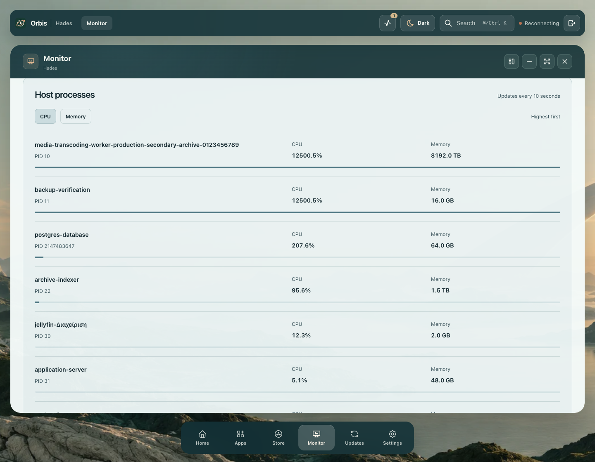
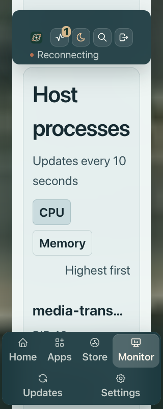

# Host process source checks

[Actual Linux source assertions](linux-source-proof.json) record a temporary source Unix handler on the owned arm64 guest. This does not update the installed helper or the healthy beta42 core. Hades is unchanged.

Two real samples cover 123 readable processes with 20 CPU and 20 memory rows. The first sample has immediate memory readings and no invented CPU comparisons. A bounded workload in the probe itself measures 19.856% CPU, against an independent process-time/wall-time reading of 19.896%. Resident memory matches independent kernel `statm` within the declared 2 MiB tolerance for asynchronous RSS. Rankings are ordered and selected fields contain no command arguments, environment, paths or executable links. Query paths are rejected; the collector is idle and the temporary server closes.

The final source hashes identify the tested handler/collector. Installed helper bytes and the exact healthy beta42 core remain unchanged. Backend authentication, selected contract validation, fixed-path Unix transport, cache coalescing, deadline and response-size limits pass source tests. There are 447 passing backend tests, 78 common tests and 111 Python tests, including 26 independently authored process regressions. Package types/builds pass.

The independent suite caught nonprintable Unicode labels and numeric PID aliases; both are corrected. It also covers CPU above 100%, PID reuse, counter reset, actual per-process elapsed times, first/long-gap samples, RSS units, deterministic rankings, bounded scan/read/time limits and one blocked worker retaining stale data without blocking readers.

[Installed-helper assertions](installed-helper-proof.json) separately verify the actual guarded upgrade after a dated private 13-file backup, SHA-256 `a6b8dc319f265f03bf6c6b7a56d46f88df320f62ccbeed8df9573e543d2adde5`. Only the handler and new process module change. Environment/unit bytes and all other scripts match the archive. Service/socket/scripts retain private permissions and the exact healthy beta42 core remains unchanged. Actual host/core socket reads match. Two real samples cover 123 processes with 20 CPU and 20 memory rows; a bounded probe workload reads 19.758% CPU against independent 19.734%, and RSS matches `statm` within the declared tolerance. The initial HTTP response takes 2.24ms.

## Compiled Monitor presentation

The controlled source inspection covers 16 layouts: 1440, 768, 390 and 320px, in both modes with native and doubled computed text. It checks exact CPU/memory order and values, full accessible process names, whole-word text, shared card gutters, control padding and keyboard focus. The separate About inspection covers the same 16 layouts and keeps its final text at least 22.33px above the actual content clip and dock. All six colour presets in both modes pass the small-label check; the conservative contrast minimum is 4.814:1.

The layout run passed all 16 layout cases but then failed a harness wheel-position assumption; its overall result remains false in the retained report. The separate About run corrects that assumption by checking visible ink and comfortable clearance at the real end of the document. A later functional run found a real refresh defect: moving a keyed PID caused native scroll anchoring to jump 327px. The process list now opts out of anchoring while the surrounding content remains eligible, preserving focus when the list grows.

These source captures use controlled process and preference fixtures, including deliberately extreme values. They are not readings from the installed server. [Source hashes](source-provenance.json) confirm that the final candidate differs from the layout/palette/About candidate only by the list's nonpainting scroll-anchor declaration.

Reports are split into referenced JSON parts to stay below the repository file-size gate. Replacing each single-key `$ref` object with the referenced JSON, relative to its index directory, reconstructs the complete original object; this was checked by deep equality.

- [16 layout cases; later harness failure retained](source-layout/index.json)
- [12 preset/mode combinations](source-colours/index.json)
- [16 About clearance cases](source-about/index.json)
- [Rejected refresh jump](rejected-reading-position/index.json)
- [Final functional run](source-functional/index.json): 40 state cases, ten Retry flows, ten two-second warmup polls, five 10,005–10,011ms ranking refreshes with exact scroll preservation, five 8-to-20-row growth cases retaining visible About focus, and zero polling while minimized or on another route. Retry completion preserves focus moved to another control, and process readings remain usable when core telemetry is unavailable. No browser errors, unexpected mutations or cleanup failures occur.

The final functional run uses the corrected list-anchor candidate. Its source hashes are recorded separately from the earlier layout/palette/About runs. Root directly inspected desktop, tablet Retry and doubled-phone title/value/growth captures.

### Reproduce source inspection

With the compiled static preview at `http://localhost:8080`, run `node scripts/visual-qa.cjs` with a fresh `ORBIS_VISUAL_SCREENSHOT_DIR` and one of these flags:

- `ORBIS_VISUAL_HOST_PROCESSES_ONLY=1`: complete layout and functional inspection.
- `ORBIS_VISUAL_HOST_PROCESSES_FUNCTIONAL_ONLY=1`: focused state, focus, refresh and polling inspection.
- `ORBIS_VISUAL_HOST_PROCESSES_ABOUT_ONLY=1`: About text clearance in all 16 layouts.
- `ORBIS_VISUAL_HOST_PROCESSES_COLORS_ONLY=1`: all six presets in both modes.

Published-core API/render confirmation remains required before claiming a released feature. Full product, history/sensor and migration acceptance remain open.
