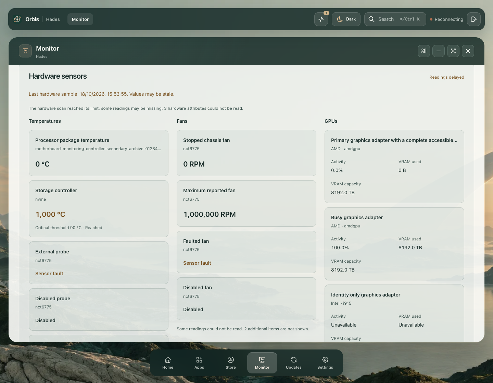

# Hardware sensors: compiled source

Source fixtures after beta45, with explicit unavailable hardware and no fabricated readings. The rehearsal helper is separately upgraded and verified; the installed beta45 core does not contain this API or presentation yet. Hades is untouched.

[Enlarged phone reading](phone-double-reading.png) · [Wrapped fallback](phone-double-fallback.png) · [Empty hardware](phone-empty.png) · [Failed scan](phone-failed-scan.png) · [Error recovery](desktop-retry.png)

## Accepted scope

- Ten layouts: native 1440/768/390/320px in both modes, plus doubled computed text at 320px in both modes. Readings cover zero, maximum/minimum supported values, fault/disabled/unavailable channels, critical thresholds, AMDGPU metrics and identity-only GPUs. Whole words, gutters, comfortable card padding, full-title identifier ellipsis and native About label/Space/focus pass.
- All six colour presets in both modes pass small-text contrast against conservative black/white wallpaper composition. Minimum contrast is 4.913736643:1. A final doubled-phone layout confirms the colour-only correction; its root-relative geometry exactly matches the earlier candidate.
- Nine states distinguish loading, collecting, disconnected helper, true empty hardware, failed empty scans, limited empty scans, partial coverage, stale values and HTTP errors. Failed/limited scans do not claim that hardware is absent. Valid zero readings remain zero; unavailable readings have no invented values.
- Actual collecting warmup takes 2,014ms. A 30,008ms cached-error refresh preserves complete About focus and its viewport anchor within 0.203125px, while the browser legitimately changes the native scroll offset.
- Keyboard Retry rejection preserves cached values and Retry focus; recovery focuses the surviving heading. Moving away before recovery prevents focus theft. Separate 31-second minimized and hidden-route intervals issue zero sensor reads.

All accepted runs have zero browser errors, mutations or preference writes; routes, listeners, text enlargement and viewport are restored and browsers close. Root manually reviews final desktop palette, enlarged-phone fallback and recovery captures. This is one Chrome engine with controlled computed text enlargement, not native browser zoom, touch, physical numeric sensor verification or full-product acceptance.

## Retained corrections

The initial driver fallback was single-line ellipsis with an empty title. It now wraps ordinary words and retains its full title. A small Light/Frost fault label initially reached only 4.483367459:1 under the conservative dark-wallpaper bound; scoped warning ink is strengthened without changing layout rules. Both product negatives remain false in the retained reports.

Separate verifier corrections are retained: an impossible top-alignment demand for a visible bottom-of-document control; treating `data-fallback="false"` as true; and expecting ready rows in an initial HTTP-error state. A final capture-only pass reveals fitting short-state text with native wheel movement; earlier heading-only photographs are partial views. No post-refresh scroll/focus correction masks an interaction result.

The acceptance combines ten layout subcases from an otherwise false contrast report, twelve palette/seven state subcases from an otherwise false expected-data report, and the complete final functional run. The colour correction leaves markup and layout rules unchanged. A subsequent string-only edit removes a duplicated stale-data warning and is checked separately at narrow initial-error and desktop cached-error views. Failed reports are not relabeled. [Complete parsed reports](report-index.json) reconstruct recursively using their manifests; [final provenance](provenance.json) records executed verifier versions, source/compiled assets, exact product differences and captures.
