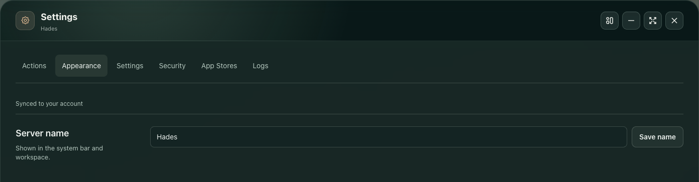

# Published beta34 UI and OTA checks

These are actual viewport captures from the published image on the isolated arm64 test homelab. The desktop alignment and 4K images are direct browser clips of their viewports. No scrolling images are stitched together.

- Tag: `v0.1.0-beta.34`
- Source: `acfa8bb1da3ad3b904b42ce017765ebdd0754b53`
- Image: `sha256:f664228c65ff2044c34d1866bb5504d37d91934f0c289a8dbef4790adf9c302d`
- Release workflow: `38852735805`, passed
- Settings: 20 groups, 320–3840px, both themes, native/doubled text
- Stores: eight real-data phone groups; no store mutations
- Short screens: two 320×400 enlarged-text focus groups

The heading icon, tab strip, dividers and form content share a gutter (maximum difference 0px). The divider clears the final tab row by 12.5px; minimum tab side padding is 13px. Independent visual review found no fractured/clipped labels or alignment defects in these captured Settings surfaces. Short-screen Import settings focus clears both the sticky bar and dock.

HTML, JavaScript, CSS, account/app/store and host reads are real. Light/dark appearance and default focused placement are fulfilled only in the browser; text is enlarged locally for stress cases. Actual preferences, both full app records and both stores match before/after. No actual write, browser error or cleanup failure occurred. [Sanitized assertions](assertions.json) record the measured scope.

The reviewed beta32→34 OTA completed at the exact healthy image and retained app records, preferences and 28 task outcomes. Its stopped beta32 snapshot was independently verified. A separate 33-entry application/data/configuration comparison matched bytes, permissions and ownership. A fresh password login succeeded and closed only the new session; its capture is blank before credentials were entered.

The separate beta34 window flow audit was **not passed**: it found cancelled preference saves despite functional navigation/placement assertions and restored original state. Beta35 source serializes those writes; its released flow acceptance is separate. Hades, physical devices, other browsers and complete production acceptance remain outside this evidence.

[Desktop light](settings-light-desktop.png) · [Tablet enlarged](settings-tablet-text200.png) · [Phone](settings-phone.png) · [320px enlarged](settings-narrow-text200.png) · [4K enlarged](settings-4k-text200.png)

[Phone Stores focus](stores-phone-text200-focus.png) · [Narrow Stores](stores-narrow-text200.png) · [Short-screen focus](settings-short-text200-focus.png) · [Fresh login](login-phone.png)
