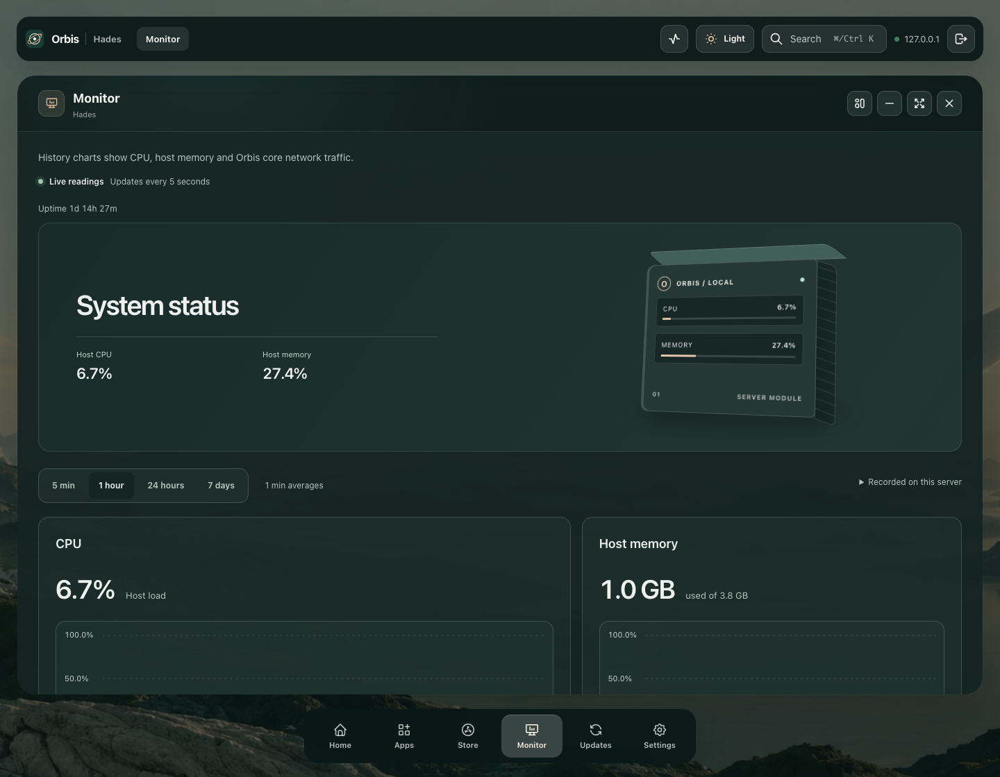

# Published beta43: host processes and glass

These are actual viewport captures from the owned arm64 Colima installation after the reviewed beta42→43 browser update. The saved server label is Hades; the real Hades server was not accessed or modified.

Release `v0.1.0-beta.43` resolves to `aa7cb6afa15abe5e56075fc4ca2d6a8f5ccc3722`, OCI index `sha256:85466caef871350b9034287d024fe71dfea27ae670c12197b61df1bfdcdeee86`, with linux/amd64 and linux/arm64 verified. [Release, OTA and independent data assertions](release-and-data-assertions.json) record the exact boundaries.

[Actual CPU rankings](1440x1120-text1-cpu-refreshed-actual-viewport.png) · [Tablet memory rankings](768x1024-text1-memory-actual-viewport.png) · [Phone readings](390x844-text1-cpu-refreshed-actual-viewport.png) · [Doubled phone text](320x800-text2-cpu-refreshed-actual-viewport.png)

## Actual published page

Five groups pass: native 1440/768/390/320px and doubled computed text at 320px. The existing Dark/Frost preference is read unchanged. Actual samples contain 122–126 readable processes, with 20 CPU and 20 memory rows. Names, accessible titles, order and displayed values match the latest actual API response in each selected ranking. One real sample also reports an unreadable process explicitly.

A separate unauthenticated request returns 401; authenticated reads return 200. All 128 forwarded browser API reads and 90 distinct fingerprinted published assets succeed. Six actual ten-second polls arrive after 10,018–10,091ms, preserving exact reading position and focused sort control; one group needs a second poll for a distinct helper sample. All five groups receive a distinct sample. Native Tab/Space/Enter, comfortable wrapping or full-title ellipsis, image decoding and chrome checks pass. Root directly reviews desktop chrome, CPU rows, tablet memory and doubled-phone captures. Bars retain the shared palette blur with no bright white frame rims.

Response bodies are unchanged. The controlled boundary is one doubled-text group and a browser-only same-origin CSP header adjustment. There are no preference shadows, response substitutions, mutations, external requests, redirects, browser errors or cleanup failures. Complete preference, installed-app and store records match after the audit. Five group contexts, the authenticated reader, anonymous context and browser close. Screenshots retain actual wheel/focus reading positions; none are reset for presentation.

[Complete sanitized assertions](assertions.json) reference one measurement file per group. Replace each single-key `$ref` object with its referenced JSON relative to this directory to reconstruct the original report exactly; deep equality and its canonical SHA-256 were verified. Full account records and raw API samples remain private. Published captures show the process names/PIDs displayed by Monitor.

## Upgrade and preservation

Reviewed browser job `20f864e4-f786-4f2e-9c6d-4e01a152aeef` reaches the exact healthy beta43 image. Preferences, both app records and all 28 saved task outcomes remain intact. The stopped beta42 snapshot independently verifies 3,591 entries, 2,827 files and 149,850,550 bytes, tree hash `9e9e6fc0c875a8569384c504e9a5b5b933c2cbf2e40794b6e22ed3202dadd0a9`. Its root stays private; protected apps, app data, user configuration and repositories match current trees. The separate original 33-entry/17-file Mac baseline still matches `7f4c0a000362ee45d1cca9c2e9b9c8a5f65dc0c9478444c04b1090dd542456d2`.

The [installed helper upgrade](../host-processes/installed-helper-proof.json) has its separate dated backup and real CPU/RSS attribution. Core OTA does not update that helper. The [source fixture gallery](../host-processes/README.md) separately covers all six presets in both modes, extreme values and failure/focus states. Authentication code is unchanged; the original session is reused without new password attempts. The copied x86 authenticator fixture remains on beta40. Full product and real-data migration acceptance remain open.
