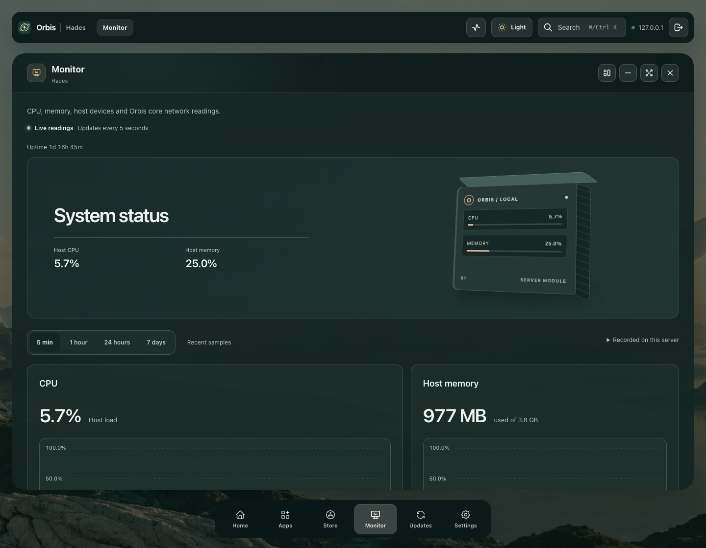

# Published beta45: device history and glass

These are actual readings and viewport captures from the owned isolated Linux arm64 rehearsal at immutable beta45. The saved label is Hades; the real Hades server was not accessed or modified.

[Desktop history inspection](1440x1120-text1-network-before-poll-actual-viewport.png) · [Tablet chart](768x1024-text1-network-inspection-actual-viewport.png) · [Phone Monitor](390x844-text1-initial-actual-viewport.png) · [Doubled phone inspection](320x800-text2-disk-inspection-actual-viewport.png)

## Actual published browser checks

The full current matrix passes native 1440/768/390/320px and doubled computed text at 320px. Every group selects real network/disk history at five minutes and one hour; recorded averages, peaks, counts and dates match actual API responses. Native Tab/Home/ArrowRight/End inspection, focus clearance, readable words, deliberate identifier ellipsis and interior padding pass. Four actual active polls preserve exact natural scroll, focused chart and inspected timestamp; the measured consecutive intervals are 10,017/10,013ms. All 188 forwarded browser API reads and 95 fingerprinted published assets succeed.

The bars share `blur(28px) saturate(1.45)` with translucent palette backgrounds. Desktop frames are transparent, without white rims or inset sheen; titlebars share the dock blur. Tablets/phones use ordinary pages without window controls. Root directly reviews desktop chrome, tablet charts, native phone and doubled-phone captures.

No response bodies/preferences are substituted, no mutations occur and complete prior beta43 preference/app/store objects still match after both updates, restart and this audit. Every browser context/reader closes; no read/asset/browser/cleanup error occurs. [Complete sanitized UI report](published-ui/report.json) · [Record preservation](post-restart-ui-records-proof.json) · [UI provenance and capture hashes](ui-provenance.json).

The controlled boundary is one doubled-computed-text phone group, OS dark media preference and a browser-only same-origin CSP header restriction. Actual saved appearance is Dark/Frost. The separate source matrix covers all twelve preset/mode combinations. This does not verify native browser zoom, Safari/Firefox, touch or every route.

### Unresolved first refresh flag

The first actual desktop attempt fails its exact-scroll assertion. That earlier verifier throws before retaining exact pre/post-poll geometry, so its cause remains **unresolved**. Two bounded instrumented desktop reproductions and the subsequent full matrix preserve exact offsets, painted chart position, cursor and focus without weakening the assertion. The diagnostic process card below history shrinks/grows without clamping the reader. These passes do not establish why the first run failed. [Original rejected report](unresolved-first-ui-poll/report.json) · [Original failure capture](unresolved-first-ui-poll.png) · [Selected diagnostic measurements and limits](refresh-diagnostics.json). Broader refresh stability remains an audit item.

## Runtime collection and restart

| Gate | Result and evidence |
| --- | --- |
| Autonomous collection | 130.006 seconds without browser viewers or probe reads; available persistent collection, nine distinct samples at observed 10–20-second intervals, 11 independently calculated device-minute rows and 257 saved summaries. [Complete report](background-history/report.json) |
| Stopped witness | Exact private journal captured while the same core container was stopped. [Report](stopped-history/report.json) |
| Restart continuity | Same container/image, healthy new start; 11 partial-device rows retained, 50 next-minute raw rows, 362/81/26 saved tier rows and 443 summaries compared without double counting. Same-minute merging was not exercised by this restart. [Report](restart-history/report.json) · [Lifecycle proof](restart-control-proof.json) |
| OTA and data | Reviewed beta44→45 update reaches the exact image. Prior full app/store/preferences match; independent stopped snapshot and protected trees match. [Snapshot](stopped-snapshot-proof.json) · [Record comparison](prior-records-proof.json) |

All 11 current device-generation digests match independent kernel readings. Anonymous/authenticated history reads return 401/200; eight invalid/repeated-query cases return 400. Numeric readings, timestamps, counts, means, peaks, source digests and assertions are retained. Device names are deterministic pseudonyms; container IDs are hashes. Full account baselines, credentials and raw execution reports remain private.

[Provenance](runtime-provenance.json) records private execution-report hashes, sanitized parsed hashes and the exact guarded runtime verifier. Split JSON restores recursively: concatenate `$orbis_array_parts` and merge `$orbis_object_parts`. Every complete parsed report is reconstructed and compared before retention. The Mac explicitly uses `colima-runtipi-test`; `default` in a snapshot belongs to the isolated guest. No Hades deployment, physical-device UI or complete product acceptance is implied.
