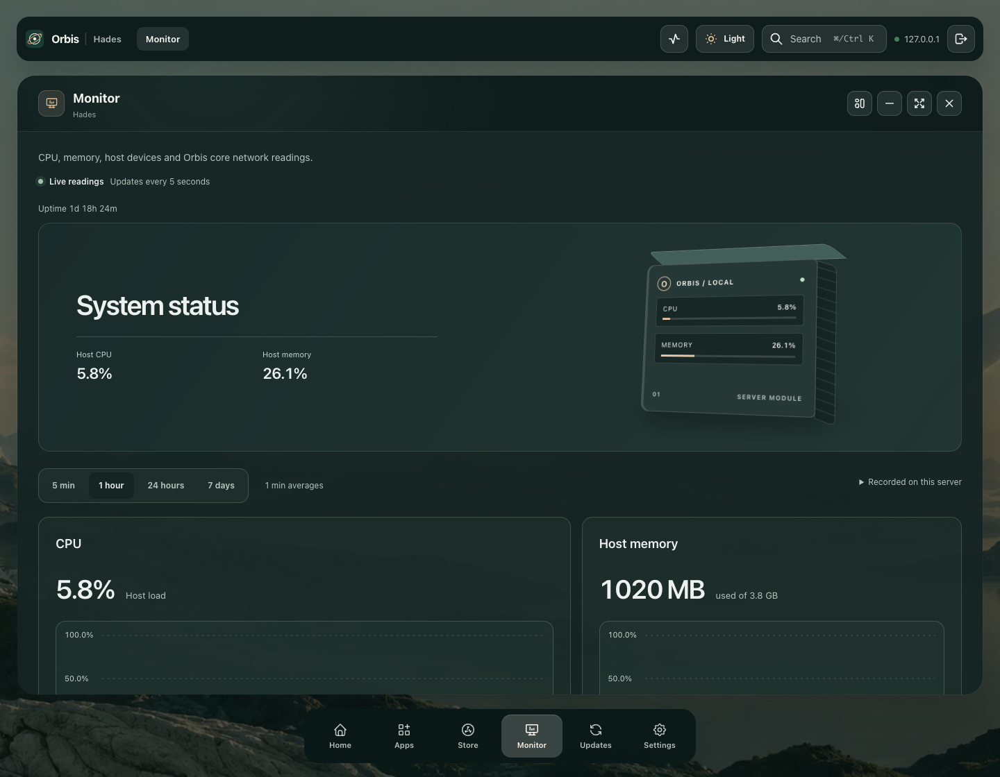

# Published beta46: hardware sensors and glass

These are actual captures and reads from the owned isolated Linux arm64 rehearsal on immutable beta46. Its saved label is Hades; the real Hades server was not accessed or changed.

[Desktop hardware panel](1440x1120-text1-true-empty-reading-actual-viewport.png) · [Tablet](768x1024-text1-about-reading-actual-viewport.png) · [Phone](390x844-text1-about-reading-actual-viewport.png) · [Doubled phone text and focused About](320x800-text2-about-focused-actual-viewport.png)

## Published browser checks

Five groups pass: native 1440×1120, 768×1024, 390×844 and 320×800, plus doubled computed text at 320×800. Sensor reads return 200 and a separate anonymous request returns 401. All three sensor lists are genuinely empty, matching independent enumeration of kernel devices. The UI shows an explicit empty state without fabricated cards or readings. Physical numerical sensor/GPU readings remain unverified.

Native About label, Space and Tab interactions, complete focus markers, whole words, readable wrapping and related gutters pass. Panel padding is 28px on desktop/tablet and 18px on phones; About has 8px vertical and 12px horizontal padding with an 8px glyph gap. Tall enlarged content is inspected at separate natural wheel/focus positions. Phones/tablets use ordinary pages without window controls.

The top bar, coloured titlebar and dock share `blur(28px) saturate(1.45)` and translucent palette backgrounds. The desktop frame is transparent, without a white rim or inset sheen. Root and the UI auditor directly inspect desktop and phone captures. Actual saved appearance is Dark/Frost; the separate source matrix covers twelve preset/mode combinations.

A real 30,008ms sensor refresh retains the focused About control at exactly 905.90625–941.5px. Its complete 6px focus marker stays inside the 189.75–1001px content clip, with zero viewport drift; natural content scroll remains 8017px. This checks this sensor refresh, not every timer/route or the cause of beta45's earlier unexplained history-scroll flag.

All 179 authenticated API reads and 96 unique published assets succeed, including seven sensor reads. No response bodies/preferences are substituted, no mutations or external requests occur, and complete app/store/preference objects still match the prior beta45 baseline. Every group, reader, anonymous context and browser closes. [Complete sanitized report](published-ui/report.json) · [Manifest](published-ui/manifest.json) · [Execution and capture hashes](ui-provenance.json).

The controlled boundary is OS dark media preference, one doubled-computed-text group and a browser-only same-origin CSP header restriction. This does not verify native browser zoom, other browsers, touch, every route or the full product.

## Reviewed update and data

- [Independent release proof](release-proof.json): source `762d7e0b5042e3993bb25fc65c3cff763be9579f`, linux/amd64 and linux/arm64, OCI index `sha256:2cb89cd81a7e5b58a849df85c43803408e8ae234b2cf426dbbc47d63ca14a287`.
- Actual UI [changelog](ota-changelog.png) and [review](ota-review.png), then one plan/apply, complete beta45→46 job `465defdf-1521-4bfd-8fbb-9f61800d3512` on the exact healthy image. Both app records, full app/store/preferences and 28 saved task outcomes/retention metadata match. Generated top-level task read timestamps are validated and excluded. [Update/records proof](ota-and-records-proof.json).
- The first checker rejects that generated timestamp before opening a page, creating a plan or applying an update. Its false result is preserved as a verifier error. [Rejected comparison](rejected-ota-read-timestamp-proof.json). No product defect is inferred.
- The private stopped beta45 snapshot independently verifies 3,593 entries, 2,828 files and 150,349,395 bytes; tree SHA-256 `4ec23bbc8284bb5ee65bbe701306840eadc0d3c98511743302c2782d72c920c8`. Protected app/data/user-config/repository trees match. [Snapshot](stopped-snapshot-proof.json).
- The separately upgraded helper matches all 13 source modules and private permissions. Host/core-mounted reads match, existing telemetry/process endpoints work, and kernel enumeration confirms zero temperature/fan/GPU devices. The core remains unchanged during this read probe. [Installed helper](installed-sensors-proof.json).

[Runtime provenance](runtime-provenance.json) records selected proof and private execution hashes. Full account/task baselines remain private. The Mac uses `colima-runtipi-test`; `default` in the snapshot belongs to the isolated guest. The copied x86 authenticator fixture remains beta40. Physical numerical readings, full theme packs, multiple homelabs and copied real-data migration acceptance remain open.
