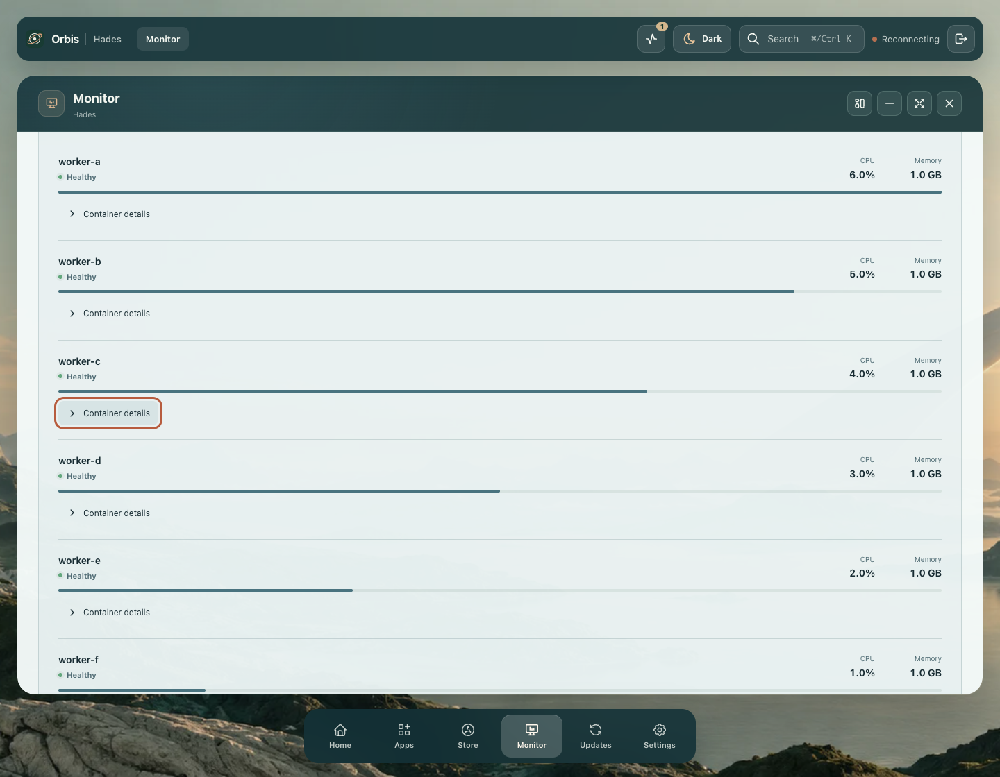
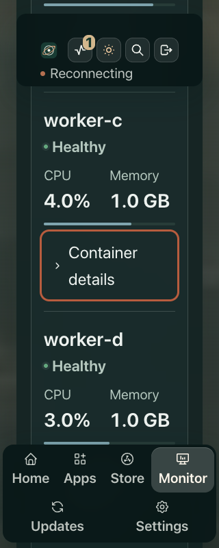
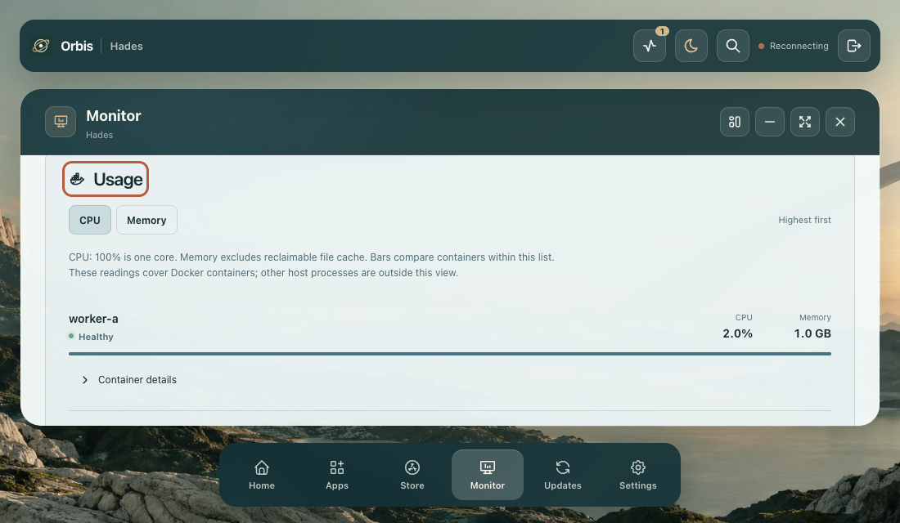

# Monitor refresh and focused Docker rows

Compiled-source fixture checks after beta45; the installed core remains unchanged. These results do not establish the cause of the earlier beta45 live scroll flag.

## Accepted scope

Twenty cases exercise existing five/ten-second query timers while host-device lists grow, shrink, disappear or reorder; Docker rankings grow, shrink or reorder; and host process counts change. Ten cases run at 1440×1120 in Light/Ocean and ten at 320×800 in Dark/Ocean with doubled computed text. Native scroll offsets are recorded separately from actual viewport geometry: browser compensation may change an offset while retaining the reading position. Chart/control viewport drift is at most 0.953125px, with complete focus markers and inspection panels visible.

Three additional cases remove the currently focused Docker row at 1440×1120, 1100×640 and doubled-text 320×800. Focus moves to the surviving Usage heading with its entire marker visible. Each also moves focus away before removal and verifies no focus theft or viewport drift. Actual details-label clicks and native Space verify semantic disclosure behavior; wrapped lines share a text edge and retain 12px horizontal/8px vertical padding.

The source fix snapshots the active row control before keyed DOM moves, retains its viewport position and minimally reveals its full focus marker. Passive chart readers are unaffected. Root manually inspects the desktop/phone reorder and fallback captures, including the smallest desktop window. All accepted runs have zero browser errors, mutations or preference writes; cleanup and browser closure pass.

## Retained rejections and verifier corrections

- The original focused-row reorder clips the full marker behind the window edge. A separate interim removed-row fallback leaves only 0.390625px clearance. Both are product defects; both reports remain false.
- The phone preparation initially demands more space than its real chart and inspection need. Native wheel preparation now solves the actual available space before the update. It never corrects scroll/focus after an update.
- A later hard 8px comfort threshold rejects a 7.96875px inspection gap even though complete visibility and the 1px anchor gate pass. Comfort spacing alone now permits half a physical pixel (`0.5/devicePixelRatio` CSS pixels); hard complete visibility has no tolerance. The original threshold rejection remains false. This does not excuse the clipped-row or 0.390625px fallback negatives.
- The no-steal verifier initially uses a CPU selector shared by Docker and Host processes. It is scoped to the Docker section; that strict-selector failure is retained separately.

The accepted 23 cases combine the ten desktop subcases in an otherwise false report, a fresh complete ten-case phone run and a fresh three-case removal run. Failed reports are not relabeled. [Acceptance selection](acceptance.json), [complete reports](report-index.json) and [source/asset/capture fingerprints](provenance.json) record the exact boundary and differing executed verifier versions. JSON parts reconstruct each original parsed report without loss. Computed text enlargement, controlled fixtures and one Chrome engine are not real hardware, native browser zoom or full-product acceptance.
